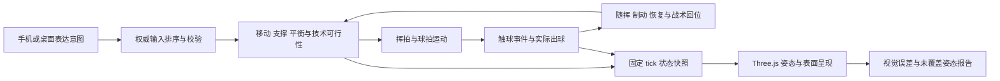

# P0-3 共享打球接口规格

类型定义见 [`shared/play-contract.d.ts`](../shared/play-contract.d.ts)。这是后续 P2／P3 的接口契约，当前正式比赛与联机仍使用旧三球种，没有发送新字段。旧场景报告独立使用 `rally-p0-recording/1`，不能强行转换为完整的新权威状态。

## 职责和数据流

| 边界 | 负责 | 不得越权 |
| --- | --- | --- |
| 输入层 `InputIntent` | 稳定的控制／进攻／高球意图、方向、按住与释放、移动、回位辅助偏好 | 不提交出球速度、比分、触球点、身体状态、球员身份或“已命中” |
| 权威输入 `AcceptedInput` | 绑定连接身份、输入序列、接受 tick、拒绝原因；按接受的按下／释放时间算蓄力 | 不让客户端用时间戳倒改已结束回合 |
| 身体 `BodyMotionState` | 位置、速度、朝向、支撑、制动／转向、平衡与再次启动能力 | 不从渲染骨骼或 FPS 推导比赛判定 |
| 挥拍 `SwingState`／`RacketState` | 技术阶段、可达区域、握拍、拍头与拍面轨迹、触球窗口 | 动画混合不能任意越过触球约束；未命中不能自动保证落点 |
| 触球 `ContactEvent` | 实际触球、来球与球拍相对运动、出球、可追踪解释量、唯一事件 ID | 一个 ID 不能修改两次球速或比分；不依赖动画剪辑名称判定 |
| 恢复 `RecoveryState` | 随挥、落地、平衡、制动、战术目标与用户覆盖 | 不把动画 recovery 当作恢复平衡或到达战术位置 |
| 画面 `PresentationInput` | 读取相邻快照，做动作采样、适配、辅助骨与最终姿态修形 | 不回写比分、权威触球、支撑或球路 |

## 坐标、时钟和可重复性

- 米、秒、米／秒、弧度；世界坐标 +Y 向上，side 0 初始在 +Z，面向向量由 `(-sin(heading), 0, -cos(heading))` 给出。所有向量默认为世界坐标，局部量必须带 `local` 名称和参考节点。
- 模拟 60 Hz，`tick` 为非负整数。触球在步内使用 `subTick ∈ [0,1)`，绝对时间为 `(tick + subTick)/60`；求交细分允许更高频，不能改变外层输入排序。
- 快照保存随机数状态、待处理输入、挥拍和支撑窗口、恢复状态、最后输入／手势／触球序号。只存人物坐标不足以做确定性恢复。
- 暂停不推进比赛 tick、支撑窗口、挥拍和恢复；连接计时、超时可以使用独立宿主时钟。恢复时先清掉暂停期间未接受的触摸状态。
- 倒带从完整快照重放已接受输入；重新计算未来缓存，不能复用未来支撑、混合或事件消费状态。相同输入、规则、运动模型及随机状态应产生相同权威结果。
- 表现层可在 30／60／120 FPS 插值，不能借渲染帧推进权威状态。非确定的浮点／版本变化须标版本差异；需要跨平台网络确定性时另做结果一致性测试。

## 输入与技术选择

- `move` 模长不超过 1；`aim` 是对方半场的意图目标，不是保证落点。拒绝非有限数字、越界枚举和过长标识符；数值边界和历史窗口在 P2 中以共享常量固定。
- 一个 `swingSequence` 对应按下→保持→释放或取消；握持长度由权威接受 tick 算出，不接受伪造 `charge`。
- 同情境可以表达三种意图。可行技术由高度、位置、时机、朝向、速度、支撑和平衡共同选择；选择采用稳定阈值／滞回，避免按钮提示在边界反复跳变。
- 拒绝或受限结果返回明确原因。可达性不足不能悄悄转换成无代价理想球；发球单独处理。
- 防守是情境，具体技术仍为挡、抽、挑等；不以一个“防守”动画代替不同出球行为。正反手是握拍／动作属性，不能由球场端号决定。

## 触球、支撑与恢复

- 触球 ID：`matchId:rallyId:contactSequence`；权威以序号去重，声音／粒子另按“回放游标世代＋事件 ID”消费。倒带播放可以重新发一次表现效果，但不能重复修改模拟球速。
- `ContactEvent` 保存挥拍 ID、实际触点、球拍姿态和速度、身体状态、入射和出射速度、约束误差、出球模型版本。没有实际触球时不造零误差事件。
- `FootSupport.anchor` 在同一支撑窗口内固定；离地、换支撑才换锚点。`loadFraction` 和 `balance` 是控制模型参数，未经实测校准不得称为力平台或生物力学测量。
- 回位目标只依据己方已发生击球、对手已观测位置与可推断覆盖区；`observedOpponentTick <= snapshot.tick`。禁止读取未来对手输入。
- `balanced`、`atTacticalTarget`、`canInitiateSwing` 分开；连续平抽可以在未回场地中心时启动下一拍。玩家移动优先覆盖回位辅助，仍受制动和转向限制。

## 表现层顺序与误差归属

固定顺序：动作选择／采样／混合 → 根部与朝向、足地适配 → 击球、握拍和球拍约束 → 辅助骨 → 最终局部姿态驱动修形 → 渲染和表面检查。

`PresentationDiagnostics` 记录接触时拍头误差、支撑窗口漂移、真实服装穿插和修形覆盖。没测就为 `null`／`not-measured`，不填 0；未覆盖姿态有 ID，不能无界外推。诊断不能反过来令模拟偷偷认定命中。

## 传输与兼容接入清单（P2-6）

实验握手采用独立 `rally-play/1` 命名空间，同时匹配规则版本、运动模型和模拟频率。旧消息没有这套字段；不能把它误认成 v1 实验协议。双方未共同支持时明确拒绝实验模式，旧模式可独立进入，不能在比赛中静默降级。

实际接入需同时修改并验证 `shared/game.js` 的输入边界、`server/rooms.js` 的接收和快照、`src/peer-match.js` 的权威协调、`src/peer-network.js` 的握手、桌面／手机输入和 `src/network-playback.js` 的回放。不只给客户端增加按钮或动画。

P0 现有录制是旧输入／旧状态形状。P2 应增加带版本的场景适配器：从冻结初态初始化新身体与球状态；将已冻结的移动、准备和释放映射为手势及意图；保留输入时刻与对比条件；输出统一的实际触球、球路、停止和恢复观测。新增权威支撑和平衡按新模型初始化，不从旧动画骨骼伪造。旧 `replayP0` 不能直接消费 `PlaySnapshot`，这项适配尚未实现。

需验收：重复与乱序输入不重复挥拍；重复快照不重复触球；过期／过早输入明确拒绝或限窗排序；重连携带完整恢复快照；规则版本不匹配拒绝；暂停恢复无残留击球；回放与不同渲染频率结果一致。这些是后续实现要求，P0 未宣称已实现。
