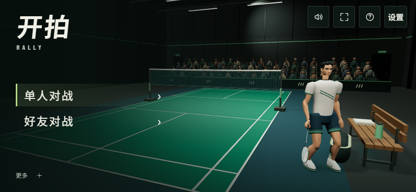
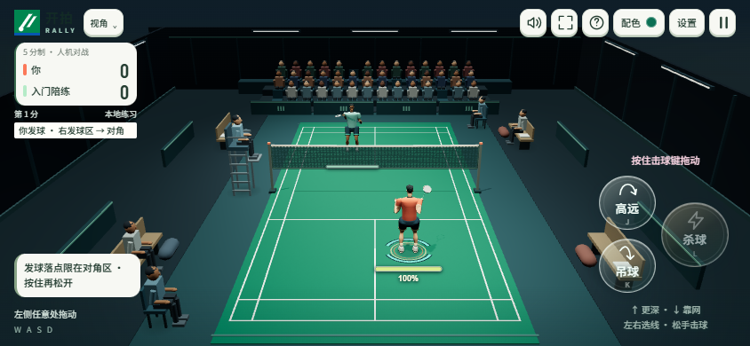

# 聚光球馆首页样板

2026-11-11，用户确认 B 概念方向。基线：远端主线 `8164ed8`（1.16.6）。本分支版本 1.17.0，等待用户视觉验收，尚未合并或部署。



当前验收构建：`c3bf4f38d8b6f6fc`，本地预览：http://127.0.0.1:3333/ 。

## 已实现

- 真实 Three.js 场馆：封闭屋顶与灯具、哑光地胶、分材质墙板、金属网柱、木质长椅、装备及实例化观众。与比赛共用 WebGL renderer，没有使用概念图充当实时场景。
- 现有人物在场边待机，脚固定、球拍下垂、轻微呼吸。导入资产维持姿势与独立材质；取消后的异步加载释放资源。
- 首页「单人对战 / 好友对战」。单人页进入「人机对战 / 地狱挑战」；返回遵循父级。好友建房、加入和既有规则配置沿用原流程。
- 短页面转场与进入比赛的渐显；系统减少动态效果时关闭。菜单不再运行示范对局。
- 准备表单整页滚动；声音与触感从首页顶部设置可用。保留主屏幕安装、操作说明、新手指南与内测群入口。
- 标题改为 Noto Sans SC 的独立字重子集，轻微倾斜与留白建立运动感；菜单使用中等字重。RALLY 与比分使用 Barlow Condensed 派生的 Rally Numerals。三套更名后的 OFL 字体自托管，总计约236KB，未覆盖的昵称字符回退到系统字体。参考 FC / TopSpin 的字体分工，并非使用其专有字体。
- 首页移除口号与重复装饰文字，社群、指南、安装和版本信息集中到原生「更多」折叠菜单，保留键盘和触控操作。
- 首页降低人物补光与环境平光；比赛内增加两盏对称柔光，保持恒定亮度与单张阴影贴图。地胶增加线性空间微表面凹凸和粗糙度；比赛座椅区木材、涂层金属独立批次处理，观众动作不变。
- 球场柔和顶光、人物补光、侧后轮廓光和上墙洗光分层处理，看台保持较暗。首次入场用1秒由86%亮度平滑提亮，稳定后变化幅度不超过1%，周期31–71秒。减少动态效果时跳过入场提亮或冻结当前灯光；返回首页不重复播放。

## 实测证据

浏览器验证由 `scripts/verify-tournament-lobby.mjs` 检查实时构建标识；本轮同时在独立服务器和用户预览端口3333复核。输出在被 Git 忽略的 `artifacts/lobby/`，不是线上测试数据。

- 1440×900、844×390、667×375、390×844 首页：入口在视口内，主要触控目标至少44px，无横向溢出。
- 两种横屏尺寸：单人选择、普通人机开局、地狱挑战开局、暂停退出、好友创建/加入准备、声音设置。
- 竖屏准备页滚动和返回；减少动态效果路径；没有页面异常或 WebGL shader 错误。
- 场馆、字体、导航、观众、球网预算、销毁及发布元数据77/77通过；后续新手指南文案调整对应9/9通过。浏览器20项检查通过，包含三套字体、比分字体实际应用，以及四种尺寸的「更多」菜单。
- 全量 node 测试 791/794。3项失败在改动前已存在：Windows创建文件/目录符号链接时报 EPERM（两个子测试及父级失败）。基线为778/781，未把这些失败写成通过。
- PWA 构建通过，116项资源。字体子集合计236424字节；没有新增模型、视频或运行时外部字体请求。首页6盏灯，比赛5盏灯，各自仅1张阴影贴图。比赛场馆静态部分保持8个实例化批次。

这些是 Windows 上 Chromium 的浏览器检查；不等于 iPhone 13 的真机性能、耗电、发热或 Safari 兼容性结论。



全量测试使用工作区 `artifacts/tmp` 作为 TEMP/TMP、并发4。首次未设置此环境时额外出现 Windows 短路径/长路径比较失败，复跑消失；保留两份原始日志，不将首次运行描述为通过。最后两句新手指南文案修改后复跑对应测试、构建和实际服务浏览器检查。

## 视觉与范围边界

概念图的人物并未作为正式资产交付。当前人物来自既有游戏资源；新人物和动作由独立人物计划继续制作。这一版完成球馆首页及实际比赛接入，并改善比赛内光照和材质；比赛镜头和玩法不变。当前转场为短渐显，不是人物走进场内的完整动画。微表面和局部光源属于实时近似，并非扫描材质或光线追踪。

## 复现

```powershell
npm ci
node --test tests/font-build.test.js tests/tournament-lobby.test.js tests/connection-recovery.test.js tests/view-dispose.test.js tests/release-notice.test.js tests/release-version.test.js
npm run build
# 将 Playwright 安装在隔离的 artifacts/qa，或设置 RALLY_PLAYWRIGHT_MODULE
npm install --prefix artifacts/qa playwright --ignore-scripts --no-audit --no-fund
node scripts/verify-tournament-lobby.mjs
```

验证脚本默认使用 Windows 已安装的 Chrome；其他环境通过 `RALLY_BROWSER_PATH` 指定 Chromium 路径。可设置 `RALLY_QA_URL` 对一个已启动的本分支服务器复核，脚本会拒绝与本地源代码构建标识不一致的服务。
