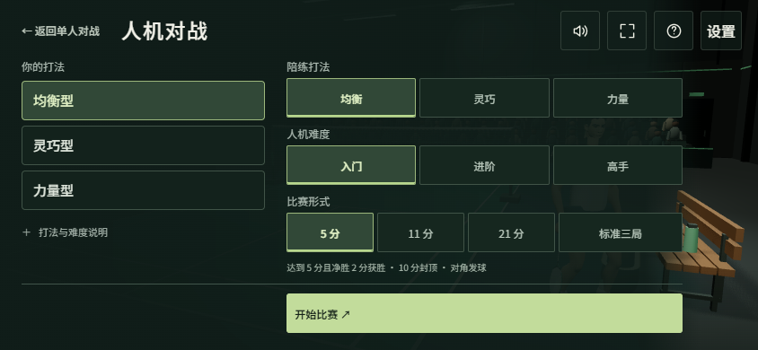
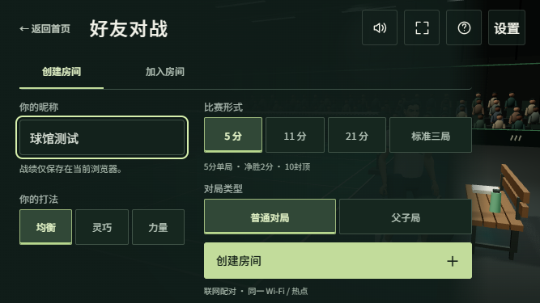

# 聚光球馆与统一对局界面

2026-11-11，用户确认 B 概念方向。基线：远端主线 `97a129b`（1.16.7，含手机旋转按钮文字修复）。本分支版本 1.17.0，等待用户视觉验收，尚未合并或部署。


当前验收构建：`82fa9ece9bca4c59`，本地预览：http://127.0.0.1:3333/ 。

## 已实现

- 真实 Three.js 场馆：封闭屋顶与灯具、哑光地胶、分材质墙板、金属网柱、木质长椅、装备及实例化观众。与比赛共用 WebGL renderer，没有使用概念图充当实时场景。
- 现有人物在场边待机，脚固定、球拍下垂、轻微呼吸。导入资产维持姿势与独立材质；取消后的异步加载释放资源。
- 首页「单人对战 / 好友对战」。单人页进入「人机对战 / 地狱挑战」；返回遵循父级。人机准备页重构为「你的打法 / 比赛设置」两栏；好友页分离「玩家信息 / 房间设置」，创建与加入采用页签，沿用真实房间与准备协议。
- 短页面转场与进入比赛的渐显；系统减少动态效果时关闭。菜单不再运行示范对局。
- 准备表单整页滚动；声音与触感从首页顶部设置可用。保留主屏幕安装、操作说明、新手指南与内测群入口。
- 标题改为 Noto Sans SC 的独立字重子集，轻微倾斜与留白建立运动感；菜单使用中等字重。RALLY 与比分使用 Barlow Condensed 派生的 Rally Numerals。三套更名后的 OFL 字体自托管，总计232720字节，未覆盖的昵称字符回退到系统字体。参考 FC / TopSpin 的字体分工，并非使用其专有字体。
- 首页移除口号与重复装饰文字，「加入开拍内测群」恢复为首页常显按钮；指南、安装和版本信息保留在原生「更多」折叠菜单，保留键盘和触控操作。
- 首页和比赛统一炭灰墙面、低饱和座椅与观众衣料，以及中性暖白主光；比赛降低平铺环境光，保留两盏对称柔光、恒定亮度和单张阴影贴图。地胶增加线性空间微表面凹凸和粗糙度；比赛座椅区木材、涂层金属独立批次处理，观众动作不变。
- 球场柔和顶光、人物补光、侧后轮廓光和上墙洗光分层处理，看台保持较暗。首次入场用1秒由86%亮度平滑提亮，稳定后变化幅度不超过1%，周期31–71秒。减少动态效果时跳过入场提亮或冻结当前灯光；返回首页不重复播放。

- 比分、击球键、设置、暂停、结果、房间、指南与安装弹窗统一深色哑光表面和淡绿色强调色。击球键保留原有触控范围、方向、蓄力与可用状态；页首重复说明和重复选项摘要删除，打法与难度说明收起，计分与联机条件保留，父子局风险说明随选择显示。





## 实测证据

浏览器验证由 `scripts/verify-tournament-lobby.mjs` 检查实时构建标识；本轮在独立服务器和重启后的用户预览端口3333复核，最终运行启用触控/移动设备模拟。Codex侧栏原标签页重载后，实际检查了常显社群按钮、新版准备页结构和计分规则，确认未停留在旧缓存。输出在被 Git 忽略的 `artifacts/lobby/`，不是线上测试数据。

- 1440×900、844×390、667×375、390×844 首页：入口在视口内，主要触控目标至少44px，无横向溢出。
- 两种横屏尺寸：单人选择、普通人机开局、地狱挑战开局、暂停退出、好友创建/加入准备、声音设置。
- 竖屏准备页滚动和返回；减少动态效果路径；没有页面异常或 WebGL shader 错误。
- 本轮场馆、字体、观众、球网、销毁、新手指南及版本测试39/39通过；最终联机恢复、字体与PWA回归98/98通过。浏览器20项检查通过，含四种视口、常显社群入口、说明折叠、父子局说明、准备页和父容器裁切检查。
- `scripts/verify-tournament-rooms.mjs`：两个独立浏览器身份，844×375房主和667×375访客，真实创建/加入房间、双方确认准备、进入对局、暂停退出均通过。本项采用本地WebSocket传输，不代表跨公网PeerJS或TURN验证。
- 全量 node 测试 791/794。3项失败在改动前已存在：Windows创建文件/目录符号链接时报 EPERM（两个子测试及父级失败）。基线为778/781，未把这些失败写成通过。
- PWA 构建通过，117项资源。字体子集合计232720字节；没有新增模型、视频或运行时外部字体请求。首页6盏灯，比赛5盏灯，各自仅1张阴影贴图。比赛场馆静态部分保持8个实例化批次。

这些是 Windows 上 Chromium 的浏览器检查；不等于 iPhone 13 的真机性能、耗电、发热或 Safari 兼容性结论。


全量测试使用工作区 `artifacts/tmp` 作为 TEMP/TMP、并发4；日志 `artifacts/lobby/full-tests-current.log`。后续初始化计分说明和原生弹窗样式修改后，复跑相关98项测试、PWA构建和实际服务浏览器检查；日志 `artifacts/lobby/final-regression.log`。

## 视觉与范围边界

概念图的人物并未作为正式资产交付。当前人物来自既有游戏资源；新人物和动作由独立人物计划继续制作。这一版完成球馆首页及实际比赛接入，并改善比赛内光照和材质；比赛镜头和玩法不变。当前转场为短渐显，不是人物走进场内的完整动画。微表面和局部光源属于实时近似，并非扫描材质或光线追踪。

## 复现

```powershell
npm ci
node --test tests/font-build.test.js tests/tournament-lobby.test.js tests/connection-recovery.test.js tests/view-dispose.test.js tests/release-notice.test.js tests/release-version.test.js
npm run build
# 将 Playwright 安装在隔离的 artifacts/qa，或设置 RALLY_PLAYWRIGHT_MODULE
npm install --prefix artifacts/qa playwright --ignore-scripts --no-audit --no-fund
node scripts/verify-tournament-lobby.mjs
node scripts/verify-tournament-rooms.mjs
```

验证脚本默认使用 Windows 已安装的 Chrome；其他环境通过 `RALLY_BROWSER_PATH` 指定 Chromium 路径。可设置 `RALLY_QA_URL` 对一个已启动的本分支服务器复核，脚本会拒绝与本地源代码构建标识不一致的服务。
