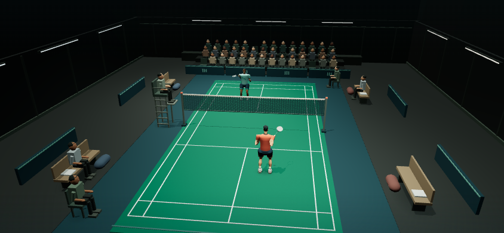

# 聚光球馆与统一对局界面

2026-11-11，用户确认 B 概念方向并授权在手机适配自测通过后合并。基线：远端主线 `97a129b`（1.16.7，含手机旋转按钮文字修复）。本分支版本 1.17.0；合并与线上部署状态以 PR #33 及部署记录为准。


最终验收构建：`c0b42fd27a2ee024`，本地预览：http://127.0.0.1:3333/ 。首页已移除「球馆预览」标记。

## 合并前手机适配验收

`scripts/verify-responsive-settings.mjs` 在 Chromium 与 WebKit 两个引擎上完成82项检查，无失败、无页面异常。每个引擎覆盖844×390、667×375、568×320、390×844、320×568，并在实际比赛中交换宽高再转回。

- 五个音量滑杆、输出数值、持久化、重置；触感开关及不支持振动时的禁用说明。
- 操作指南滚动与提示开关、新手指南、主屏幕安装说明、常显社群弹窗。
- 好友创建/加入页签、昵称和房间码；人机准备、实际开局、视角上下限与重置、所有球场配色。
- 按键编辑器的预设、保存和取消；工具栏分组不重叠，击球键和暂停键在旋转后可达。
- 最小横屏真实等待30秒暂停结算，检查结果页和再赛；返回首页无横向溢出。

本轮修复三项实际问题：320px竖屏比赛工具栏挤出暂停键；准备页滚动后标签被顶部按钮遮挡；窄屏按键编辑器标题与预设重叠。准备页改为在顶部工具栏下方独立滚动，编辑器使用两行工具栏。截图人工复核补充了自动点击检查。

最终构建另通过首页/普通与地狱开局20项、入场和实际发球5项、双身份本地WebSocket房间3项检查。房间脚本改为在同一个浏览器任务内记录入场状态和控件可见性，避免独立远程读取跨过1.8秒动画终点导致误报。重启3333服务后核验build ID与源码一致；侧栏原标签已实际显示无预览标记的首页，并再次完成入场、暂停和返回。

日志与截图：`artifacts/responsive/`、`artifacts/lobby/release-audit.log`、`artifacts/lobby/release-rooms.log`、`artifacts/entrance/release-audit.log`。全量本地测试797/800，仍仅3项Windows符号链接EPERM环境失败；构建通过，119项资源。合并还须以最终提交的Linux CI通过为条件。

以上为Windows桌面浏览器引擎的移动视口/触控模拟，不等于iPhone真机、Safari实机性能、系统键盘/刘海安全区或跨公网PeerJS/TURN测试。

## 已实现

- 真实 Three.js 场馆：封闭屋顶与灯具、哑光地胶、分材质墙板、金属网柱、木质长椅、装备及实例化观众。与比赛共用 WebGL renderer，没有使用概念图充当实时场景。
- 现有人物在场边待机，脚固定、球拍下垂、轻微呼吸。导入资产维持姿势与独立材质；取消后的异步加载释放资源。
- 首页「单人对战 / 好友对战」。单人页进入「人机对战 / 地狱挑战」；返回遵循父级。人机准备页重构为「你的打法 / 比赛设置」两栏；好友页分离「玩家信息 / 房间设置」，创建与加入采用页签，沿用真实房间与准备协议。
- 页面保留短转场。首次从候场进入比赛时，镜头用约1.8秒沿外弧抬升至当前玩家设置的比赛机位，顶灯从边侧向半场收拢，随后显示HUD与操作键。减少动态效果时直接进入比赛；菜单不运行示范对局。
- 准备表单整页滚动；声音与触感从首页顶部设置可用。保留主屏幕安装、操作说明、新手指南与内测群入口。
- 标题改为 Noto Sans SC 的独立字重子集，轻微倾斜与留白建立运动感；菜单使用中等字重。RALLY 与比分使用 Barlow Condensed 派生的 Rally Numerals。三套更名后的 OFL 字体自托管，总计232720字节，未覆盖的昵称字符回退到系统字体。参考 FC / TopSpin 的字体分工，并非使用其专有字体。
- 首页移除口号与重复装饰文字，「加入开拍内测群」恢复为首页常显按钮；指南、安装和版本信息保留在原生「更多」折叠菜单，保留键盘和触控操作。
- 首页和比赛统一炭灰墙面、低饱和座椅与观众衣料，以及中性暖白主光；比赛降低平铺环境光，保留两盏对称柔光、恒定亮度和单张阴影贴图。地胶增加线性空间微表面凹凸和粗糙度；比赛座椅区木材、涂层金属独立批次处理，观众动作不变。
- 球场柔和顶光、人物补光、侧后轮廓光和上墙洗光分层处理，看台保持较暗。首次入场用1秒由86%亮度平滑提亮，稳定后变化幅度不超过1%，周期31–71秒。减少动态效果时跳过入场提亮或冻结当前灯光；返回首页不重复播放。

- 比分、击球键、设置、暂停、结果、房间、指南与安装弹窗统一深色哑光表面和淡绿色强调色。击球键保留原有触控范围、方向、蓄力与可用状态；页首重复说明和重复选项摘要删除，打法与难度说明收起，计分与联机条件保留，父子局风险说明随选择显示。


## 入场与阴影

- 单人入场期间冻结权威比赛时钟并禁用输入；隐藏页面暂停展示，恢复后不补算动画耗时。好友入场仅使用既有3秒准备倒计时；剩余时间不足、已进入活跃比赛、断线恢复与直接再赛不播放阻挡操作的入场。权威开赛状态到达时立即结束展示。
- 镜头继承实际候场起点，绕开球网沿外弧抬升，保留玩家的比赛视角设置和两侧朝向；横竖屏变化重新计算终点。
- 人物身体和双脚使用渐隐软边接触阴影，脚抬起时阴影消退。羽毛球影子随高度扩散和变淡，并沿主光方向偏移；与预测落点标记保持区分。
- 首页与比赛各一张2048×2048主光阴影图；场内仅木材、金属器材新增投影，看台观众不增加投影绘制。静态场馆8个实例化批次，加1个内侧墙顶壳体绘制；壳体背面剔除避免高机位被挡住。阴影降级时仍保留接触阴影。
- 实录：`artifacts/entrance/match-entrance-preview.webm`（本地7秒剪辑，未加入运行时资源）。完整录制、分段截图与诊断在同目录。



## 实测证据

浏览器验证由 `scripts/verify-tournament-lobby.mjs` 检查实时构建标识；本轮在独立服务器和重启后的用户预览端口3333复核，最终运行启用触控/移动设备模拟。Codex侧栏原标签页重载后，实际检查了常显社群按钮、新版准备页结构和计分规则，确认未停留在旧缓存。输出在被 Git 忽略的 `artifacts/lobby/`，不是线上测试数据。

- 1440×900、844×390、667×375、390×844 首页：入口在视口内，主要触控目标至少44px，无横向溢出。
- 两种横屏尺寸：单人选择、普通人机开局、地狱挑战开局、暂停退出、好友创建/加入准备、声音设置。
- 竖屏准备页滚动和返回；减少动态效果路径；没有页面异常或 WebGL shader 错误。
- 本轮场馆、字体、观众、球网、销毁、新手指南及版本测试39/39通过；最终联机恢复、字体与PWA回归98/98通过。浏览器20项检查通过，含四种视口、常显社群入口、说明折叠、父子局说明、准备页和父容器裁切检查。
- `scripts/verify-tournament-rooms.mjs`：两个独立浏览器身份，844×375房主和667×375访客，真实创建/加入房间、双方确认准备、进入对局、暂停退出均通过。本项采用本地WebSocket传输，不代表跨公网PeerJS或TURN验证；本轮新增双方入场在原准备倒计时内完成的检查，已通过。
- 本轮最终全量 node 测试797/800。3项失败在改动前已存在：Windows创建文件/目录符号链接时报EPERM（两个子测试及父级失败）。针对入场、阴影、主循环、联机回放、观众、球网与销毁的98/98通过。全量首次运行发现测试场景夹具缺少新灯光成员，以及旧的全场馆不投影断言；补齐夹具并限定仅金属/木材投影后复跑，最终只余上述3项环境失败。
- PWA 构建通过，119项资源。字体子集合计232720字节；没有新增模型、视频或运行时外部字体请求。首页6盏灯，比赛5盏灯，各自仅1张阴影贴图。比赛场馆静态部分保持8个实例化批次。

`scripts/verify-match-entrance.mjs` 的5项浏览器检查通过：844×390镜头抬升与比赛时间为零、结束后真实蓄力发球、667×375期间旋转至竖屏再返回、减少动态效果、无页面异常。在独立服务和重启后的3333端口运行，核验build ID为00f3b5263a88adab。侧栏旧标签曾加载旧SW缓存；待实际安全更新完成后再次开局，观察到data-entering=true的低机位以及结束后false和恢复的HUD。

这些是 Windows 上 Chromium 的浏览器检查；不等于 iPhone 13 的真机性能、耗电、发热或 Safari 兼容性结论。


全量测试使用工作区 `artifacts/tmp` 作为 TEMP/TMP、并发4；本轮日志 `artifacts/lobby/entrance-full-tests-final.log`，针对性回归日志 `artifacts/lobby/entrance-regression.log`。此前布局版本的日志保留，未混写为本轮检查。

## 视觉与范围边界

概念图的人物并未作为正式资产交付。当前人物来自既有游戏资源；新人物和动作由独立人物计划继续制作。这一版完成球馆首页及实际比赛接入，并改善比赛内光照和材质；比赛镜头和玩法不变。当前入场为实际摄像机与灯光协同运动，不含人物走进场内的完整动画。微表面和局部光源属于实时近似，并非扫描材质或光线追踪。

## 复现

```powershell
npm ci
node --test tests/font-build.test.js tests/tournament-lobby.test.js tests/connection-recovery.test.js tests/view-dispose.test.js tests/release-notice.test.js tests/release-version.test.js
npm run build
# 将 Playwright 安装在隔离的 artifacts/qa，或设置 RALLY_PLAYWRIGHT_MODULE
npm install --prefix artifacts/qa playwright --ignore-scripts --no-audit --no-fund
node scripts/verify-tournament-lobby.mjs
node scripts/verify-tournament-rooms.mjs
node scripts/verify-match-entrance.mjs
```

验证脚本默认使用 Windows 已安装的 Chrome；其他环境通过 `RALLY_BROWSER_PATH` 指定 Chromium 路径。可设置 `RALLY_QA_URL` 对一个已启动的本分支服务器复核，脚本会拒绝与本地源代码构建标识不一致的服务。
